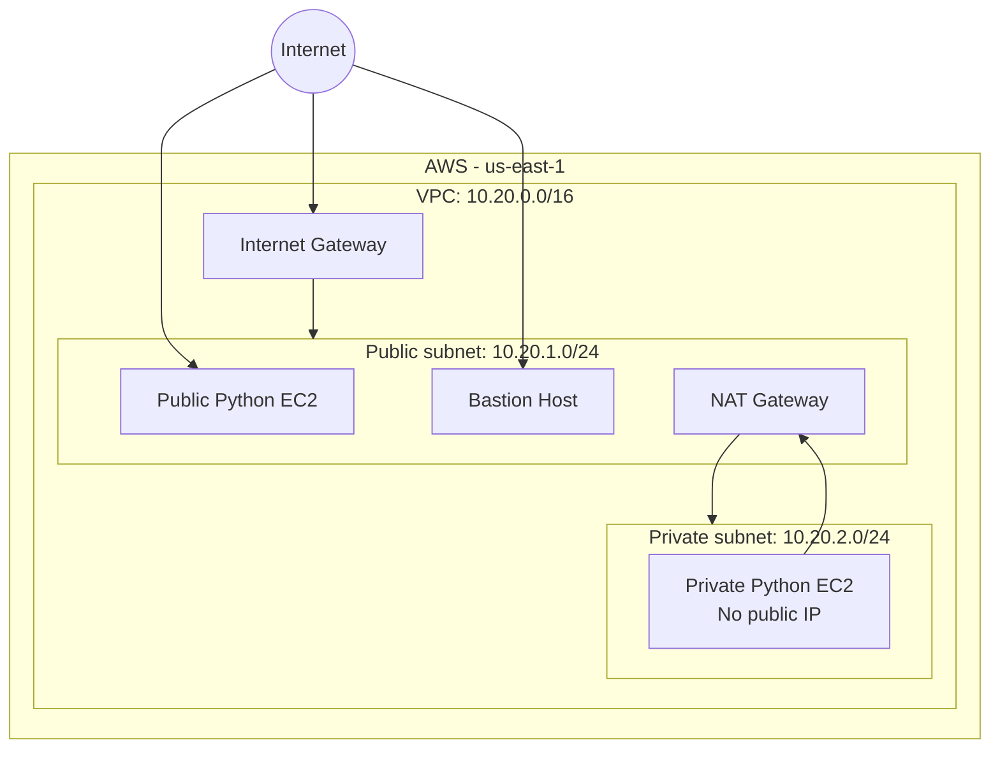
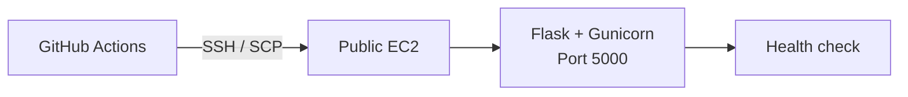
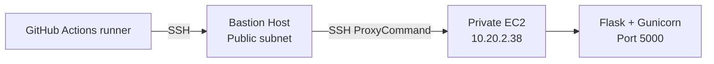
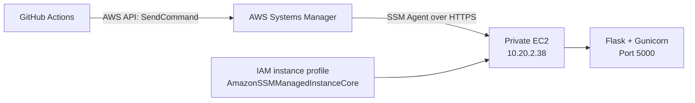

# Terraform + GitHub Actions: AWS EC2 Python Application Deployment

A hands-on AWS deployment project that provisions networking and EC2 infrastructure with **Terraform**, then deploys a Python Flask application using **GitHub Actions**. It demonstrates three deployment approaches:

1. Public EC2 deployment over SSH.
2. Private EC2 deployment through a Bastion Host.
3. Private EC2 deployment through AWS Systems Manager (SSM) Run Command.

The project uses IAM access keys stored as GitHub Actions secrets. **GitHub OIDC is not configured in this lab.**

---

## Project overview

- **Application:** Python Flask JSON API
- **Web server:** Gunicorn
- **Process management:** systemd
- **Infrastructure as Code:** Terraform
- **CI/CD:** GitHub Actions
- **Cloud provider:** Amazon Web Services
- **Region:** US East (N. Virginia) - `us-east-1`
- **Availability Zone:** `us-east-1a`
- **EC2 operating system:** Ubuntu
- **Instance type used in the lab:** `t3.micro`

### Application endpoints

| Endpoint | Purpose | Expected response |
|---|---|---|
| `/` | Application information | JSON welcome/deployment message |
| `/health` | Health check | `{"status":"healthy"}` |

The Flask application listens on port `5000`.

---

## Architecture

### 1. AWS infrastructure

Terraform provisions a VPC with public and private subnets, an Internet Gateway, a NAT Gateway, route tables, security groups, and EC2 instances.



The private subnet uses the NAT Gateway for outbound internet access (for example, package installation and cloning the public repository). The private application instance does not have a public IP address.

### 2. Deployment approaches

#### Approach A - Public EC2 using SSH



The `deploy-public.yml` workflow discovers the public EC2 instance by its Name tag, temporarily allows the GitHub runner's IP address for SSH, copies the application, deploys it, checks the health endpoint, and removes the temporary SSH ingress rule.

#### Approach B - Private EC2 through a Bastion Host



The `deploy-bastion.yml` workflow connects to the Bastion Host and uses it as an SSH jump host to copy and deploy the application to the private EC2 instance.

#### Approach C - Private EC2 through AWS Systems Manager



The `deploy-ssm.yml` workflow uses AWS Systems Manager Run Command to execute deployment commands on the private EC2 instance. The instance is selected by the tag:

- Key: `Role`
- Value: `Private Application Server`

This method does not require SSH access or a Bastion Host for deployment. The private instance must have an attached IAM role with `AmazonSSMManagedInstanceCore`, a running SSM Agent, and network connectivity to Systems Manager endpoints.

---

## Repository structure

```text
.
├── .github/
│   └── workflows/
│       ├── terraform-infrastructure.yml
│       ├── terraform-destroy.yml
│       ├── deploy-public.yml
│       ├── deploy-bastion.yml
│       └── deploy-ssm.yml
├── app/
│   ├── app.py
│   └── requirements.txt
├── scripts/
│   └── deploy.sh
├── main.tf
├── variables.tf
├── providers.tf
├── outputs.tf
├── terraform.tfvars
├── terraform.tfvars.example
└── README.md
```

---

## AWS infrastructure configuration

| Component | Configuration |
|---|---|
| AWS Region | `us-east-1` |
| Availability Zone | `us-east-1a` |
| VPC CIDR | `10.20.0.0/16` |
| Public subnet | `10.20.1.0/24` |
| Private subnet | `10.20.2.0/24` |
| Public routing | Internet Gateway |
| Private outbound routing | NAT Gateway |
| EC2 instance type | `t3.micro` |
| Application port | `5000` |
| SSH login user | `ubuntu` |
| Terraform state bucket | `aws-python-app-github-actions-deployments` |
| Terraform state key | `aws-python-app/terraform.tfstate` |
| State encryption | Enabled |
| S3 native state locking | Enabled with `use_lockfile` |

The S3 state bucket is a pre-existing backend resource. It is not created or destroyed by this Terraform configuration. Keep it private and do not delete it when cleaning up the lab.

### EC2 roles and tags

The private EC2 instance is tagged with:

| Tag key | Tag value |
|---|---|
| `Name` | `python-github-actions-private-ec2` |
| `Environment` | `lab` |
| `Role` | `Private Application Server` |

The SSM workflow uses the `Role` tag to select the private instance.

---

## GitHub Actions configuration

### 1. Repository secrets

Open **GitHub repository → Settings → Secrets and variables → Actions → Secrets**.

Create the following secrets:

| Secret | Used by |
|---|---|
| `AWS_ACCESS_KEY_ID` | Terraform, public EC2, and SSM workflows |
| `AWS_SECRET_ACCESS_KEY` | Terraform, public EC2, and SSM workflows |
| `EC2_SSH_PRIVATE_KEY` | SSH deployment to public EC2 and Bastion deployment |

Use an IAM identity with only the permissions required by the workflows. Do not use root credentials, commit credentials, or place private keys in the repository.

The SSM deployment identity needs permissions for the SSM operations used by the workflow, including `ssm:SendCommand` and `ssm:ListCommandInvocations`, along with any required resource and document permissions. The Terraform and public deployment workflows need their respective EC2, VPC, security-group, and S3 state permissions.

### 2. Production environment

Create a GitHub Environment named exactly:

`production`

The deployment and infrastructure workflows reference this environment. Configure required reviewers if approval gates are desired and supported by your GitHub plan.

### 3. Terraform inputs

Configure `terraform.tfvars` for your AWS account and region. Important values include:

- `aws_region`: `us-east-1`
- `availability_zone`: `us-east-1a`
- `ami_id`: a suitable Ubuntu AMI ID in `us-east-1`
- `key_pair_name`: an existing EC2 key pair in `us-east-1`
- `ssh_ingress_cidr`: your administrator public IP in CIDR format (prefer `/32`)
- `app_ingress_cidr`: the client IP range allowed to access the public demo application

Do not commit real credentials or private keys. Review security-group ingress before applying infrastructure.

---

## Deployment instructions

Run the workflows from the repository's **Actions** tab. Workflows are manually triggered with `workflow_dispatch`.

### Step 1 - Provision infrastructure

1. Open **Actions**.
2. Run the Terraform infrastructure workflow.
3. Review the Terraform plan.
4. Approve the apply job if the `production` environment requires approval.
5. Confirm the VPC, subnets, gateways, route tables, security groups, and EC2 instances are provisioned.

### Step 2 - Deploy to the public EC2 instance

Run **Deploy Python App to Public EC2**.

This workflow uses SSH/SCP to deploy the Flask application to the public EC2 instance. It temporarily opens SSH to the GitHub runner IP and removes that ingress rule after the deployment attempt.

Verify from a machine allowed by the public EC2 security group:

```bash
curl http://PUBLIC_EC2_IP:5000/
curl http://PUBLIC_EC2_IP:5000/health
```

### Step 3 - Deploy to the private EC2 through Bastion

Before running the workflow, ensure the Bastion Host and private EC2 are running, the SSH key secret is configured, and the Bastion can reach the private instance on port 22.

Run **Deploy Python App via Bastion Host**.

The workflow:
1. Prepares the SSH private key on the GitHub runner.
2. Connects to the Bastion Host.
3. Uses SSH ProxyCommand to reach the private EC2.
4. Copies the application package.
5. Installs requirements and restarts the `private-python-app` systemd service.
6. Checks the application's health endpoint.

The current lab workflow contains the Bastion and private-instance IP addresses directly. If you recreate the instances and their addresses change, update those values in `deploy-bastion.yml` before running it.

### Step 4 - Configure SSM for the private EC2

Before the first SSM deployment:

1. Create an IAM role trusted by the EC2 service.
2. Attach the AWS managed policy `AmazonSSMManagedInstanceCore`.
3. Attach the role as the instance profile to the private EC2 instance.
4. Ensure the SSM Agent is installed and running.
5. Ensure the private subnet has outbound HTTPS connectivity to Systems Manager through the NAT Gateway, or suitable VPC endpoints.
6. In Systems Manager, verify that the private EC2 appears under **Fleet Manager → Managed nodes** with Ping status **Online**.

The lab instance used the role name `EC2-SSM-Management-Role`. The role was configured in IAM and attached to the EC2 instance for this exercise.

### Step 5 - Deploy to the private EC2 through SSM

Run **Deploy Python App via AWS Systems Manager (SSM)**.

The workflow:
1. Authenticates to AWS using the GitHub Actions AWS credentials.
2. Sends an `AWS-RunShellScript` command to the instance tagged `Role=Private Application Server`.
3. Installs Git and Python virtual-environment support if needed.
4. Clones this public repository on the private EC2 instance.
5. Copies the Flask application files into `/home/ubuntu/python-app`.
6. Installs Python dependencies.
7. Restarts the `private-python-app` systemd service.
8. Checks the service state and calls the health endpoint.

No SSH key or Bastion Host is used by this SSM deployment workflow.

### Step 6 - Verify through Session Manager

Open **EC2 → Instances**, select the private EC2 instance, and choose **Connect → Session Manager**.

Run:

```bash
curl http://127.0.0.1:5000/
curl http://127.0.0.1:5000/health
```

Expected health response:

```json
{
  "status": "healthy"
}
```

The application can be verified from inside the private instance even though it has no public IP address.

---

## Deployment results

The three deployment workflows were run successfully during the lab:

| Deployment method | Target | Transport / service | Result |
|---|---|---|---|
| Public EC2 | Public Ubuntu EC2 | SSH + SCP | Successful |
| Bastion | Private Ubuntu EC2 | SSH through Bastion | Successful |
| SSM | Private Ubuntu EC2 | Systems Manager Run Command | Successful |

The private application was also verified using Session Manager. The root endpoint returned the Flask application JSON response, and `/health` returned `{"status":"healthy"}`.

---

## Security and cost considerations

- This is a learning lab, not a production-ready deployment.
- IAM access keys stored in GitHub secrets are long-lived credentials. Prefer short-lived credentials such as GitHub OIDC for a future production implementation; if static keys are used for this lab, restrict permissions and rotate or deactivate them after use.
- Never print or commit AWS access keys, secret keys, session tokens, PEM files, or Terraform state.
- Restrict SSH ingress to trusted IP ranges. The private EC2 security group should allow SSH only from the Bastion security group when Bastion access is used.
- Keep the S3 Terraform state bucket private, encrypted, and versioned.
- The NAT Gateway, public IPv4 addresses, EC2 instances, and EBS volumes can incur charges. Check the sandbox's quotas and billing rules, and clean up lab resources when finished.
- The public demo uses HTTP on port 5000; use HTTPS, a reverse proxy, and appropriate hardening for a real application.
- Do not remove the S3 backend bucket when destroying the lab infrastructure.

## Cleanup

When the lab is complete, use the **Terraform Destroy** workflow and review its plan carefully before approval. This removes Terraform-managed lab infrastructure, but the pre-existing S3 backend bucket is retained.

Confirm that no lab EC2 instances, NAT Gateway, Elastic IPs, or other billable resources remain. Do not destroy resources that are shared or not part of this lab.

---

## Author

**Venkata Subbarao**

- GitHub: [@VENKATASUBBARAO13](https://github.com/VENKATASUBBARAO13)
- LinkedIn: [Venkata Subbarao](https://www.linkedin.com/in/ventrapragada-venkata-subbarao)
- Portfolio: [venkata-subbarao-portfolio.vercel.app](https://venkata-subbarao-portfolio.vercel.app)
